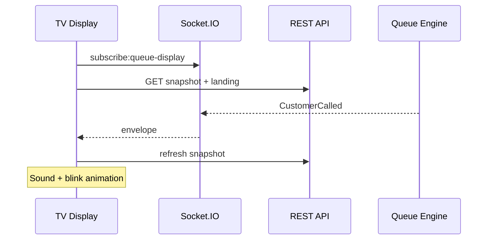

# TV Display Architecture

## Overview

```
┌─────────────────────────────────────────────────────────────┐
│                    Flutter Web (tv_display)                  │
├─────────────────────────────────────────────────────────────┤
│  GoRouter                                                    │
│    /pair → PublicPairScreen                                  │
│    /setup → StaffLoginScreen → StaffConfigureScreen          │
│    /display → DisplayScreen (4 layout modes)                 │
├─────────────────────────────────────────────────────────────┤
│  Riverpod                                                    │
│    displayConfigProvider (Hive)                              │
│    displayBoardProvider (HTTP snapshot + landing)            │
│    displayRealtimeBindingProvider (Socket.IO + poll fallback)│
├─────────────────────────────────────────────────────────────┤
│  HTTP (public)                                               │
│    GET /customer-portal/queues/:id   — branding + live stats│
│    GET /queues/:id/snapshot          — called + waiting list │
├─────────────────────────────────────────────────────────────┤
│  Socket.IO /realtime (no auth)                               │
│    emit subscribe:queue-display { queueId }                 │
│    listen CustomerCalled, CustomerCompleted, …               │
└─────────────────────────────────────────────────────────────┘
                              │
                              ▼
              backend QueueRealtimeBridge (unchanged)
```

## Realtime flow



## Display modes

| Mode | Layout |
|------|--------|
| 1 | Large "Now Serving" + next 3 |
| 2 | Split: now serving + next 10 + announcements |
| 3 | Minimal token only |
| 4 | Brand background + Mode 1 content |

## Package dependencies

Uses shared monorepo packages: `queueflow_core`, `queueflow_shared`, `queueflow_theme`, `queueflow_network`, `queueflow_models`, `queueflow_services`.

## Constraints

- Does **not** modify Queue Engine or Notification system
- Consumes existing Socket.IO events only
- No duplicate backend APIs
