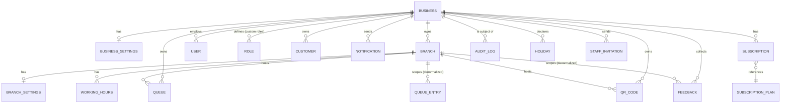
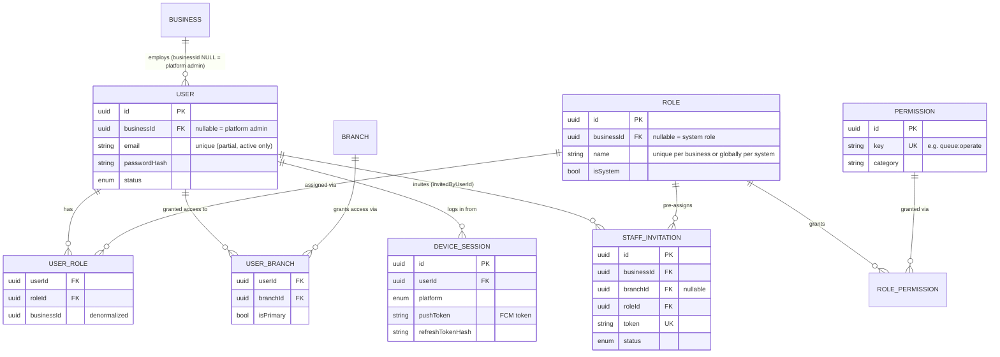
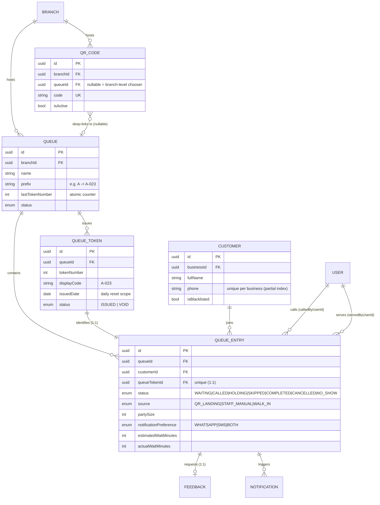
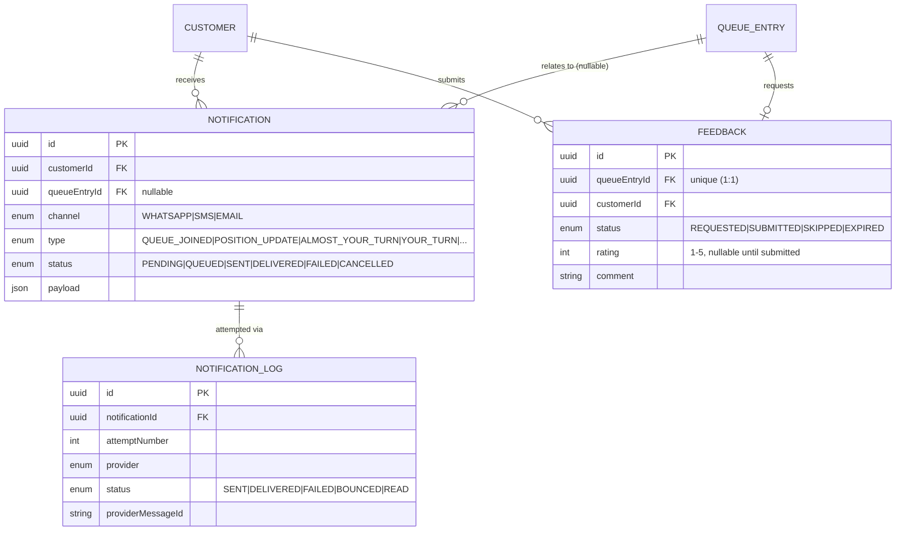
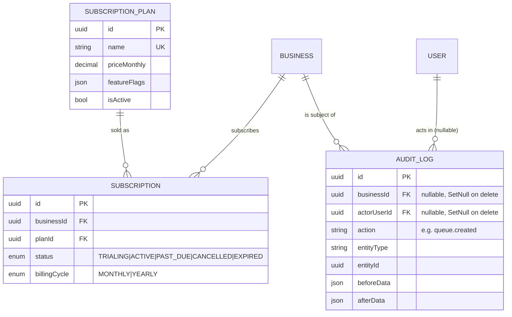

# QueueFlow — Entity Relationship Diagram

Source of truth is `backend/prisma/schema.prisma`; this document is a
human-readable view generated by hand from it. If the two ever disagree,
the schema wins — regenerate this file's diagrams rather than editing the
schema to match stale documentation.

For the reasoning behind each modeling choice below, see
[`DATABASE_DESIGN.md`](DATABASE_DESIGN.md).

## 1. High-level tenant ownership

Every table below carries `businessId` directly (see
`DATABASE_DESIGN.md` § "businessId-everywhere"). This diagram omits
scalar fields to show ownership/cardinality only.

## 2. Staff, roles & access

## 3. Queue operations — the QR-to-served flow

This is the schema backing the product flow in `PROJECT.md`: QR scan →
landing page join → live tracking → staff calls → served → feedback.

## 4. Notifications & feedback

## 5. Billing & audit

