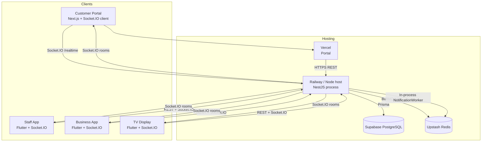
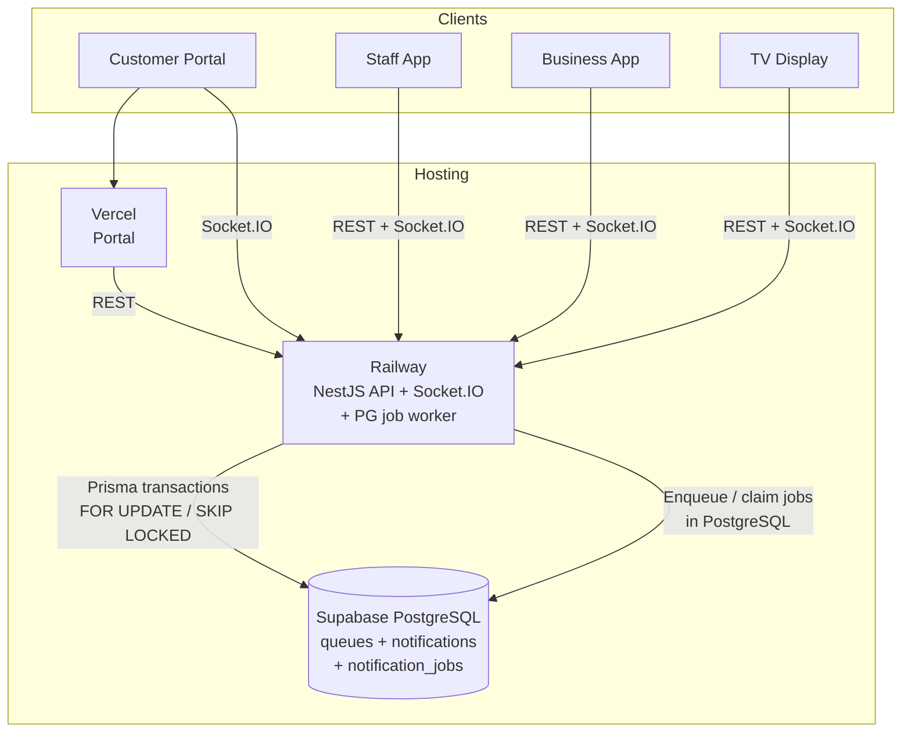
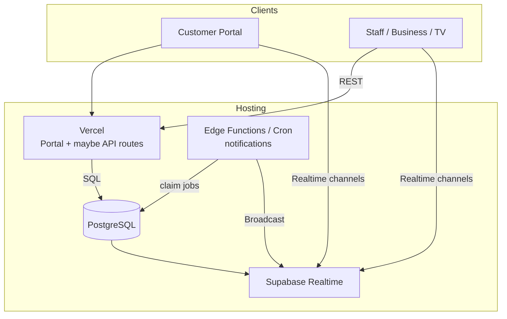
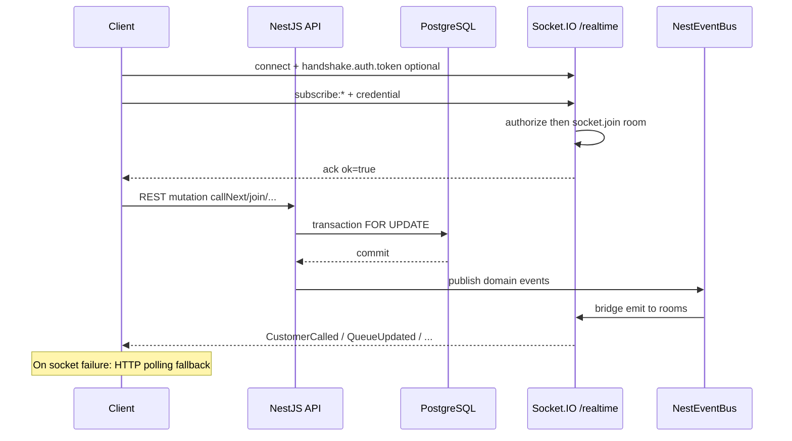
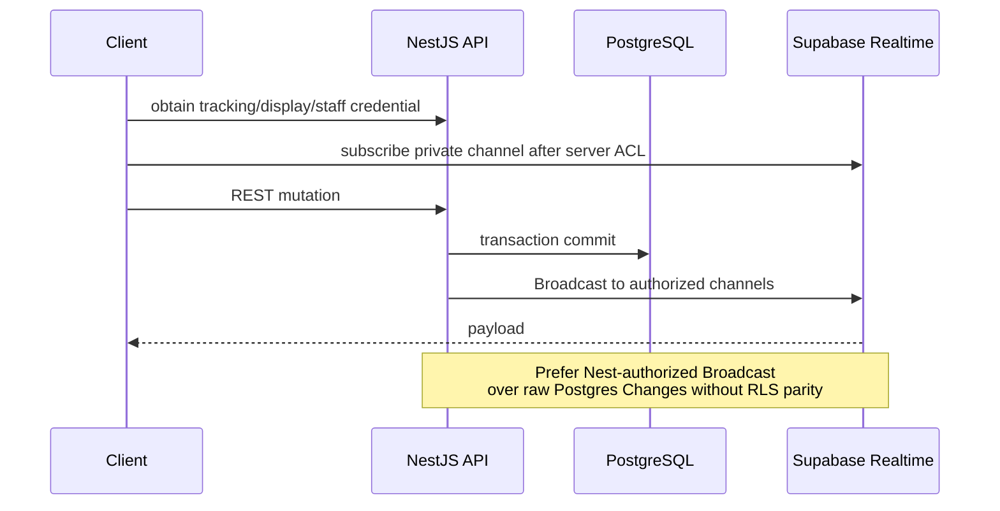
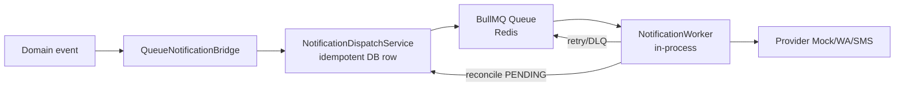
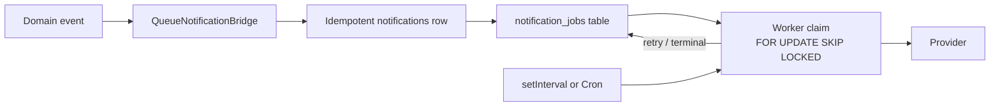

# QueueFlow — Infrastructure Architecture Diagrams

**Companion to:** `docs/INFRASTRUCTURE_COST_OPTIMIZATION_AUDIT.md`  
**Type:** Documentation only — no code or infrastructure changes.

---

## 1. Current architecture (as implemented / intended)

**Facts:** Redis is only on the notification path. Queue locks are PostgreSQL. Socket.IO has no Redis adapter today (single Nest instance).

---

## 2. Proposed cheapest safe architecture

**Vercel + Supabase + Railway (no Redis / no BullMQ)**

**Cost cut:** Remove Upstash. Keep one Node process for API + realtime + notification claiming.

---

## 3. Future optional architecture (Vercel + Supabase only)

Requires Socket.IO replacement + Nest re-platform — **not** recommended as first step.

**Risk:** Auth/authorization must be redesigned to preserve Phase 10 contracts.

---

## 4. Realtime flow (current Socket.IO)

---

## 5. Realtime flow (proposed Supabase Realtime — future)

---

## 6. Notification flow (current — Redis/BullMQ)

---

## 7. Notification flow (proposed — PostgreSQL jobs)

---

## Legend

| Symbol | Meaning |
|--------|---------|
| Solid arrow | Implemented / recommended near-term |
| Future-only diagram §3 | Requires HIGH–VERY HIGH migration |
| Audit status | Diagrams reflect code inspection, not live billing |

*No infrastructure was created or destroyed for this document.*
