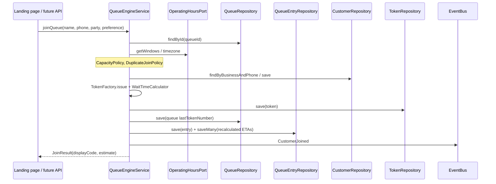
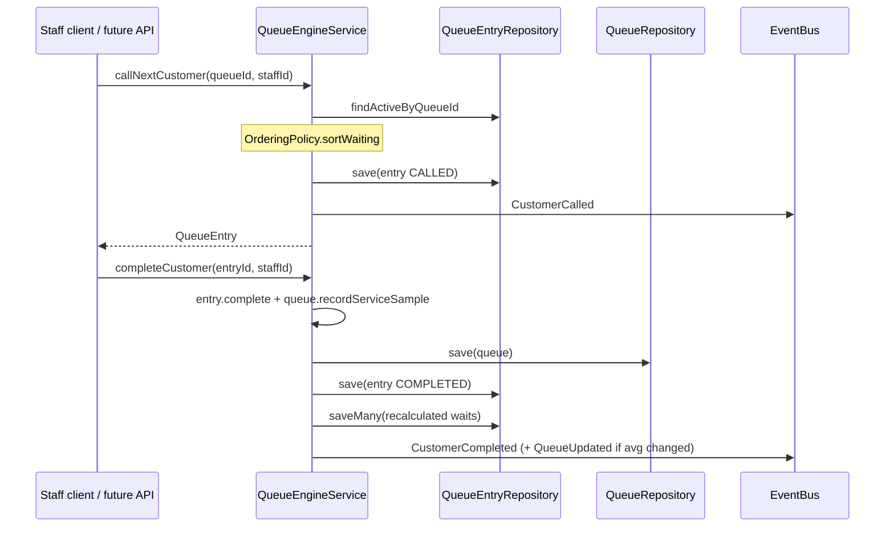
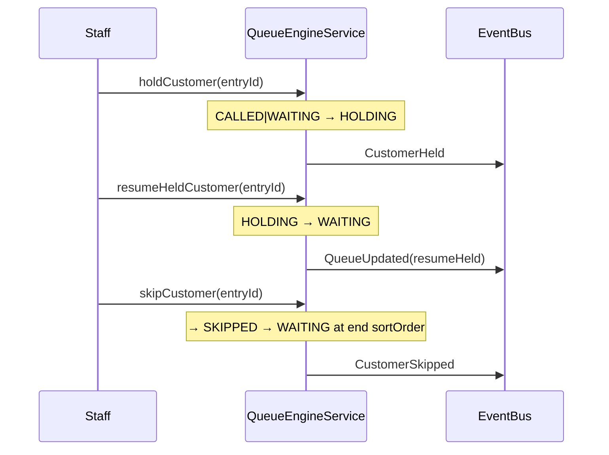
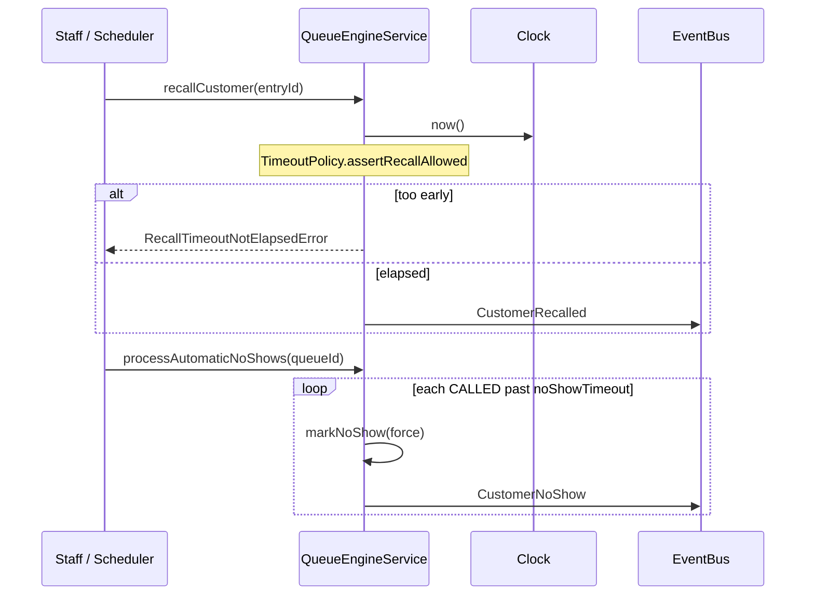
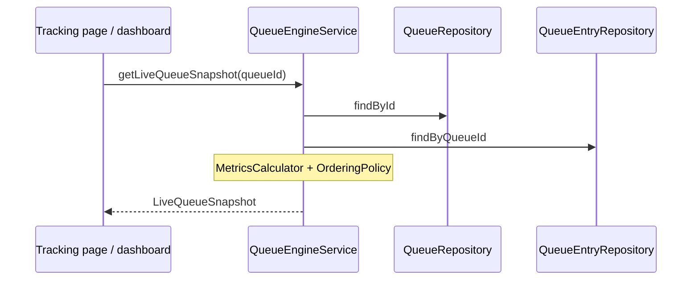

# Queue Engine — Sequence Diagrams

Companion to [`QUEUE_ENGINE.md`](QUEUE_ENGINE.md). All flows go through
`QueueEngineService`; persistence and transport are ports.

## 1. Join queue (QR landing)



## 2. Call next → complete



## 3. Hold / resume / skip



## 4. Recall and automatic no-show



## 5. Transfer between queues

```mermaid
sequenceDiagram
  participant Staff as Staff
  participant Eng as QueueEngineService
  participant Bus as EventBus

  Staff->>Eng: transferCustomer(entryId, targetQueueId)
  Note over Eng: Same businessId required
  Note over Eng: Capacity + duplicate phone on target
  Note over Eng: New token on target; entry → WAITING
  Eng->>Bus: CustomerTransferred
  Eng-->>Staff: QueueEntry (new queueId + displayCode)
```

## 6. Live snapshot (read path)



## 7. Event fan-out (future Socket.IO)

```mermaid
sequenceDiagram
  participant Eng as QueueEngineService
  participant Bus as EventBus port
  participant Mem as InMemoryEventBus (today)
  participant Sock as Socket.IO adapter (future)

  Eng->>Bus: publish(CustomerCalled)
  Bus->>Mem: handlers / published[]
  Note over Sock: Implements EventBus;<br/>subscribes and emits to rooms
```
