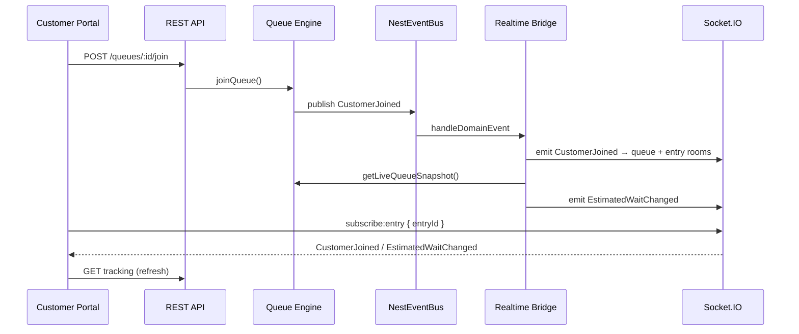
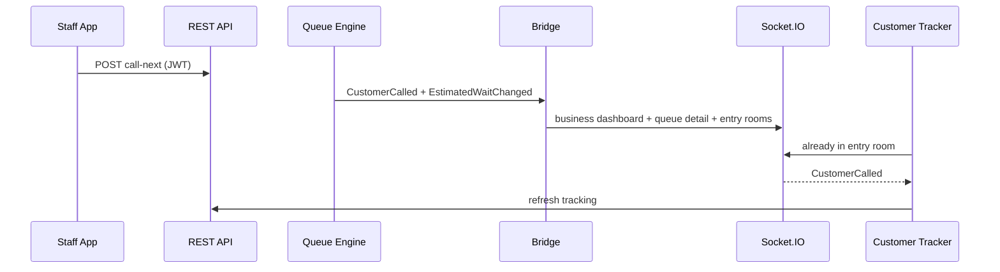

# QueueFlow Realtime Architecture (Socket.IO)

Production real-time layer bridging the Queue Engine domain event bus to Socket.IO rooms consumed by the customer portal and future staff apps.

## Overview

```
QueueEngineService
        │ publish(DomainEvent)
        ▼
   NestEventBus  ──subscribe('*')──►  QueueRealtimeBridgeService
        │                                      │
        │                                      ├─► map domain → wire events
        │                                      └─► QueueEngineService.getLiveQueueSnapshot()
        │                                               (EstimatedWaitChanged only)
        ▼
QueueRealtimeEmitterService ──► Socket.IO Server (/realtime namespace)
        │
        ├─ queue:{queueId}              (public landing + stats)
        ├─ entry:{entryId}              (public customer tracker)
        ├─ business:{id}:dashboard      (staff JWT)
        ├─ business:{id}:queues         (staff JWT)
        ├─ queue:{queueId}:detail       (staff JWT)
        └─ queue:{queueId}:display      (TV display — future)
```

## Wire events

| Socket event | Source domain event(s) |
|--------------|------------------------|
| `CustomerJoined` | `CustomerJoined` |
| `CustomerCalled` | `CustomerCalled`, `CustomerRecalled` |
| `CustomerHeld` | `CustomerHeld` |
| `CustomerSkipped` | `CustomerSkipped` |
| `CustomerCompleted` | `CustomerCompleted` |
| `QueuePaused` | `QueuePaused` |
| `QueueResumed` | `QueueResumed` |
| `QueueClosed` | `QueueClosed` |
| `QueueUpdated` | `QueueUpdated`, `QueueCreated`, `QueueOpened`, cancellations, moves, … |
| `EstimatedWaitChanged` | Emitted after wait-affecting domain events via engine snapshot |

Payload envelope:

```json
{
  "event": "CustomerCalled",
  "occurredAt": "2026-07-22T12:00:00.000Z",
  "businessId": "…",
  "queueId": "…",
  "payload": { "entryId": "…", "displayCode": "A-01" }
}
```

## Authentication

| Client | Auth | Rooms |
|--------|------|-------|
| Customer portal | None | `subscribe:entry`, `subscribe:queue`, `subscribe:queue-display` |
| Staff dashboard (future) | JWT in `handshake.auth.token` | `subscribe:business-dashboard`, `subscribe:business-queues`, `subscribe:queue-detail` |

Staff tokens use the same access JWT as REST (`TokenService.verifyAccess`).

## Customer portal

- **Primary:** Socket.IO at `{API_HOST}/realtime`
- **Fallback:** HTTP polling (15s tracking / 30s landing) when socket disconnects
- **States:** `connecting` · `connected` · `reconnecting` · `disconnected` · `offline`
- Adapter: `apps/customer-portal/src/lib/realtime/queue-realtime.ts`

On any relevant wire event, the adapter re-fetches REST tracking/landing data (no duplicated business logic in the client).

## Event flow — customer join



## Event flow — staff calls next



## Business surfaces (Part 4)

All staff/business events fan out to:

- `business:{businessId}:dashboard` — aggregate KPI refreshes
- `business:{businessId}:queues` — queue list cards
- `queue:{queueId}:detail` — operator console
- `queue:{queueId}:display` — TV display (future, room ready)

Same envelope format; clients filter by `event` type.

## Performance considerations

1. **No duplicate rules** — Socket payloads carry domain event data; full snapshots only for `EstimatedWaitChanged` via `QueueEngineService`.
2. **Room scoping** — Customers join only `entry:{id}` or `queue:{id}`; staff joins business/queue rooms after JWT validation.
3. **Debounce** — Bridge calls `getLiveQueueSnapshot` once per domain event; burst operations (e.g. batch skip) produce one emit per engine call.
4. **Fallback polling** — Customer portal polls only while socket is disconnected, limiting load during outages.
5. **Horizontal scale (future)** — Replace in-process `NestEventBus` fan-out with Redis adapter (`@socket.io/redis-adapter`) + Redis pub/sub on domain events; engine and bridge code unchanged.
6. **Transport** — Socket.IO negotiates WebSocket with HTTP long-polling fallback; suitable for mobile networks behind restrictive proxies.

## Configuration

| Variable | Description |
|----------|-------------|
| `CORS_ALLOWED_ORIGINS` | Must include customer portal origin (e.g. `http://localhost:3001`). In **development**, any `localhost` / `127.0.0.1` origin is auto-allowed (Flutter Web random ports). |
| `NEXT_PUBLIC_API_WS_URL` | Optional explicit WS host for portal (defaults to API host) |

## Source layout

```
backend/src/infrastructure/realtime/
  gateway/queue-realtime.gateway.ts
  services/queue-realtime-bridge.service.ts
  services/queue-realtime-emitter.service.ts
  services/socket-auth.service.ts
  constants/rooms.ts
  constants/socket-events.ts
  constants/domain-mapping.ts
```

## Test report

| Suite | Location | Coverage |
|-------|----------|----------|
| Domain mapping | `__tests__/domain-mapping.test.ts` | Event name mapping |
| Rooms | `__tests__/rooms.test.ts` | Room naming |
| Bridge | `__tests__/queue-realtime-bridge.service.test.ts` | Domain → socket fan-out |
| Portal polling fallback | `apps/customer-portal/src/lib/realtime/queue-realtime.test.ts` | Fallback adapter |
| Portal schemas/utils | existing vitest suites | Unchanged |

Run:

```bash
cd backend && npm test
cd apps/customer-portal && npm test
```
